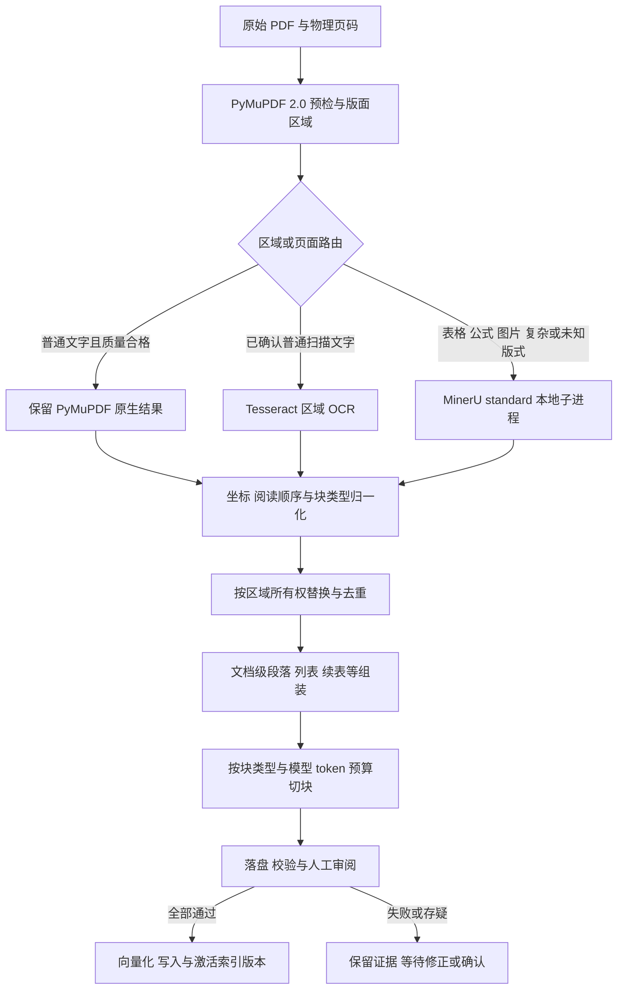

# PDF 混合解析与向量入库方案

日期：2026-10-26。状态：设计基线；核心代码已实施，实际改动、验证及边界见[改动记录](PDF混合解析改动记录.md)和[使用说明](PDF混合解析使用说明.md)。财务PDF全量人工核验与正式数据迁移尚未执行。

本文依据当前工作区代码、项目 `.venv`、独立 MinerU 环境和已有 MinerU 输出样本编写。本文中的新模块、配置、数据字段和命令标注为设计时，均不代表当前已经实现。详细接口、数据结构及改动位置见 [PDF混合解析详细设计.md](PDF混合解析详细设计.md)。

按依赖顺序排列的实施步骤、逐文件职责和测试安排见 [PDF混合解析实施计划.md](PDF混合解析实施计划.md)。本文的设计描述以实际代码与改动记录为落地依据。

## 1. 目标与已确认范围

目标链路：PDF → 页面/区域质量分析 → 混合解析 → 跨页逻辑块 → 类型感知切块 → 质量检查与人工确认 → 本地 Embedding → Chroma。

本次用户已确认：

1. 普通文字使用 PyMuPDF 2.0，表格、公式、图片及复杂版式使用 MinerU；Tesseract 仅作为普通文字识别的兜底。
2. MinerU 使用独立虚拟环境 `E:\learn_space\mineru\env\.venv`，模型根目录 `E:\learn_space\mineru\model`，档位 `standard`，本地推理。
3. 图片/图表先提取可识别的文字、表格、公式，保留图像与原页位置；图形含义和曲线数值允许人工核对，本期不扩展额外视觉模型。
4. 只有质量检查通过、人工确认后的完整解析记录允许入库。识别失败或拼接存疑时，保留产物待核对，不自动入库部分内容。
5. 初次方案编写阶段只提供文档；用户后续授权代码实施，实际状态见改动记录。真实环境配置及旧数据未覆盖。

## 2. 代码核对结论

现有 Markdown 文档描述的是部分预期能力，不能直接视为已实现。主要差异如下。

| 事项 | 当前实际实现 | 影响 |
|---|---|---|
| 主解析器 | `app/pdf_loader.py:50` 调用 `page.get_text("text", sort=True)` | 没有调用 PyMuPDF 2.0 的 Markdown/layout 入口 |
| 复杂内容 | 逐个内嵌图片做 Tesseract OCR，必要时整页 OCR | 丢失表格行列、公式结构，不能覆盖纯矢量图形 |
| 页面结果融合 | 原生文字与 OCR 文字直接拼接，并附上处理方式标签 | 可能重复、阅读顺序错误，处理标签也进入 Embedding |
| 质量路由 | 仅用原生字符数和图片 OCR 是否有结果决定整页 OCR | 没有区域质量、结构质量和复杂内容路由 |
| 配置 | loader 未使用 `LAYOUT_ENABLED/HEADER_REMOVE/FOOTER_REMOVE/TABLE_STRATEGY/OCR_DPI` | 文档宣称的能力实际不生效；渲染固定约 115 dpi |
| 页眉页脚 | loader 未删除 | CLI 却无条件显示“已在解析阶段剔除” |
| 解析日志 | `parse_log.py` 实际 schema 为 1，解析器名称却写成 `pymupdf.to_markdown` | 运行记录不能准确说明内容由谁生成 |
| 页面字段 | 缺少 `elements/raw_text/geometry/ocr_used` | 文档中的字段、OCR 提示及统计与实际输出不一致 |
| 跨页 | `rag_pipeline.build_chunks()` 逐页调用字符切块器 | 段落、续表、跨页公式没有逻辑关联 |
| 切块 | 按字符、换行和标点切分 | 没有保护表格行、数学表达式，也没有模型 token 预算 |
| 入库 | 只写单页码等少量 metadata，旧记录入库时重建这几个字段 | 即便扩展日志，新增信息仍会在入库时丢失 |
| 审阅门禁 | 没有检查质量、人工审阅状态及文件校验和 | “先检查后入库”目前是操作约定，不是程序约束 |
| 更新文档 | 只 upsert 当前 chunk ID | PDF 或切块规则改变后，旧 chunk 会残留 |

项目 `.venv` 已核实为 Python 3.12.10、PyMuPDF 2.0；有效 Markdown 入口是 `Document.to_markdown()`。模块级 `pymupdf.to_markdown` 不存在，不能照文档名称直接调用。`Document.to_markdown(page_chunks=True, use_ocr=False, ...)` 的布局结果可用于路由；`header=False/footer=False` 表示删除对应区域。现有 `TABLE_STRATEGY` 不能直接透传并假设生效，须在实现时使用该版本实际支持的接口。

README 还存在已删除文档链接、引用不存在的 `scripts.test_retrieval`、Python 版本说明自相矛盾、默认页脚删除值与配置不一致等问题；后续应随实际功能一起修订，不能提前宣称实现。

## 3. 推荐架构



路由分两层：页面质量决定是否能可靠分区，区域类型决定使用哪个引擎。复杂区域可以请求 MinerU 解析其所在完整页面，再将结构化结果按区域替换；这是“按区域选取最终内容”，不要求 MinerU CLI 原生支持裁剪区域。

首版不采用裁剪 PDF 后逐块调用 MinerU：当前 CLI 没有 bbox 参数，裁剪还会损失表头、图注及上下文，并增加坐标映射和启动成本。完整页面的结构不可靠、复杂区域占比高或融合匹配不可靠时，升级为整页 MinerU，最终正文整体替换该页，不能在原生文字之后再追加一份整页结果。

## 4. 项目如何调用 MinerU

推荐：**主项目通过子进程调用独立环境 Python 的模块入口**，不在主项目环境安装或直接 import MinerU。

已核实以下入口存在，`parse --help` 可执行：

```text
E:\learn_space\mineru\env\.venv\Scripts\python.exe
    -B -m mineru.kit.main parse <原始PDF>
    --pages 28-29 --tier standard --format zip -o <输出ZIP>
```

`Scripts\mineru-kit.exe parse ...` 也可用；推荐前一种写法，以便明确解释器和环境归属。参数应通过 `subprocess` 参数列表传递，`shell=False`，不需要激活环境。

| 方案 | 判断 |
|---|---|
| 主进程 import MinerU | 不选：独立环境无法直接共享依赖，且主项目与 MinerU 的包版本不同 |
| 独立 Python 子进程 | 首版采用：隔离依赖、调用清晰、便于保存失败证据与设置超时 |
| 独立常驻服务 | 后续性能优化选项：可减少反复加载模型；需要额外处理服务生命周期和队列，不作为首版前提 |

每个子进程显式设置模型目录、本地模型源和本地后端，清除远程 VLM 服务地址的继承值。不能只在某次 PowerShell 中设置后假设 API 进程会继承。`standard` 在当前 MinerU 4.0.12 中映射到 `effort="high"`，不是旧版的 backend 名称。

必需模型路径齐备性检查已只读通过；未校验权重内容 hash 或推理可用性，也不等于已经验证目标 PDF 的识别准确率或耗时。本轮未重新执行模型推理。

已有 `table-p28-p29.zip` 包含 `middle_json.json`、`structured_content.json`、Markdown、模型输出和图片。归一化适配器应以 `middle_json.json` 为主，保存 HTML 表格与公式；不能只读 Markdown 再按字符串猜测结构。当前实际 schema 为 `pages[].blocks`，不是旧教程中的 `pdf_info`；`page_idx` 是原 PDF 零基物理页号，bbox 是 0–1 归一化坐标。

## 5. 跨页数据处理

先保存完整物理页面序列，包括空白页和失败页，再构造跨页逻辑块；不要先过滤无文字页后再把列表中的相邻项拼接。

| 内容 | 处理规则 |
|---|---|
| 段落 | 只对物理相邻页建立续接候选，结合页边位置、段落样式、章节、句法和标点确认；遇新标题、空白/失败页停止 |
| 列表 | 保留项目层级；同一项目跨页可接续，新编号形成新项目 |
| 续表 | 用表号/续表标记、列结构、表头、单位及相邻页位置联合判断；记录重复表头删除和每行来源 |
| 公式 | 保持 LaTeX/MathML 原子性；仅有明确续式证据时合并，公式与变量说明可关联检索 |
| 图片/图表 | 保留图像、图号、图注及位置；只向量化实际提取的文字，不自动编造图意或曲线数据 |

每次合并保存输入块、规则、证据和决策；原始块不覆盖。疑似续表但列结构不一致时不强行拼接，进入待核对。

## 6. 日志与向量库调整

新解析产物统一为 schema v3，与历史 v1、文档声称的 v2 区分。

| 层次 | 主要内容 |
|---|---|
| 运行事件日志 | 结构化 JSONL：时间、run/doc/page/block、阶段、引擎、原因、耗时、错误码；控制台仍可显示简洁文字 |
| 解析审阅产物 | run、pages、blocks、logical_blocks、merges、chunks、review、manifest 与 assets；完整保留坐标、HTML/LaTeX、来源与原始引擎输出 |
| Chroma `documents` | 经人工确认的 `embedding_text`：原文加必要标题/表头/单位上下文，不含调试标签和本地路径 |
| Chroma `metadatas` | 可筛选的标量：文档与版本、页范围、类型、父块、引擎、质量、审阅及产物引用 |
| 完整结构 | 保存在审阅产物；必要时以 `*_json` 字符串冗余保存小型来源信息 |

Chroma 是 `ids/documents/embeddings/metadatas` 结构，不是新增关系表列。当前 0.6.3 的 metadata 仅接受字符串、数值和布尔值，不能直接存列表、字典或 `None`。详细字段见详细设计第 8、9 节。

来源必须支持“第 28–29 页”，并可追溯每个来源区域；不能仅把旧 `page` 改成第一页而丢掉后续来源。入库入口、检索结果、LLM 上下文和 UI 应共享同一套数据契约。

## 7. 实施顺序与涉及代码

| 阶段 | 改动重点 | 交付验收 |
|---|---|---|
| 1：数据契约与调用 | 新增统一模型、MinerU adapter、配置与预检；改造 loader | 选页正确、本地模型、不串环境、错误可见、原始资产可追溯 |
| 2：路由与融合 | PyMuPDF layout、质量评估、Tesseract 兜底、页面/区域所有权 | 普通页不重复 OCR；复杂内容进入 MinerU；每个区域只有一个最终正文来源 |
| 3：跨页与切块 | 新增逻辑块组装，替换逐页字符切块 | 续段/续表正确，公式和表格行不截断，来源页精确 |
| 4：审阅与入库 | schema v3 日志、校验和、人工审阅、统一序列化、索引版本激活 | 未确认/失败/篡改记录不能入库，两条入库路径字段一致 |
| 5：检索与展示 | 修改 vector_store、RAG、API、web_ui 和模板 | 页范围、来源定位、资产预览、实际引用一致 |
| 6：迁移与文档 | 新集合重建、回归样本、README/PROJECT-SC 同步 | 旧集合可回滚，旧日志只读兼容，文档与实现一致 |

主要修改现有文件：`app/pdf_loader.py`、`chunker.py`、`rag_pipeline.py`、`parse_log.py`、`vector_store.py`、`embeddings.py`、`logging_config.py`、`config.py`、`api.py`、`web_ui.py`、模板及三个维护脚本。新增模块与具体函数位置见详细设计第 12 节。

不将 MinerU 加入主项目 `requirements.txt`；独立环境版本与模型指纹记录进解析 manifest。主项目 PyMuPDF 则应从宽范围依赖收敛到验证通过的版本。

## 8. 验收与剩余不确定性

建议将 `frm_notes.pdf` 中第 5 页公式、第 28–29 页表格作为第一批候选样本；页码均指原 PDF 物理页码。还应补齐普通文字、普通扫描件、多栏、矢量图形、空白页、跨页段落及不应合并的相邻表格样本。

核心验收：准确恢复人工标注的表格数字/单位及公式结构、无重复正文、跨页不误并、每个 chunk 可定位回原页、未确认记录不能入库、超长内容不被 Embedding 静默截断、重复入库幂等、版本切换不暴露半成品。

仍需在实现阶段实测：standard 对当前 PDF 的准确率、旋转/cropbox 坐标对齐、跨页表格与公式效果、冷启动耗时和内存、质量阈值及 token 预算。这些属于样本标注与性能验证，不能由“模型文件齐备”推定通过。目前没有阻塞本文方案的未回答需求项；如实测发现需扩大图表语义理解范围或改变严格入库规则，应再向用户确认。
